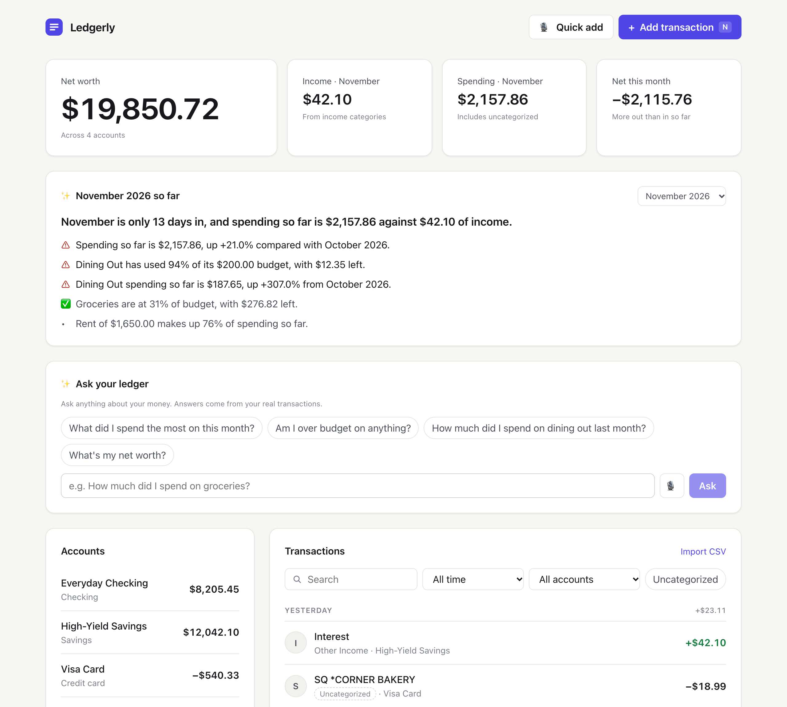
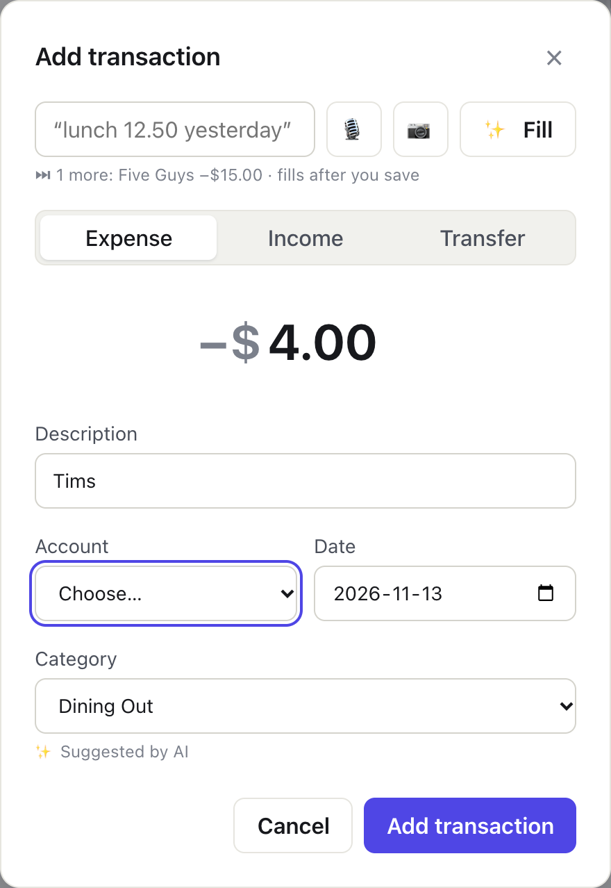
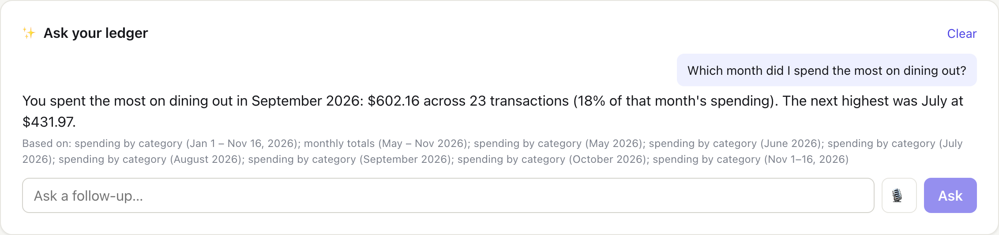
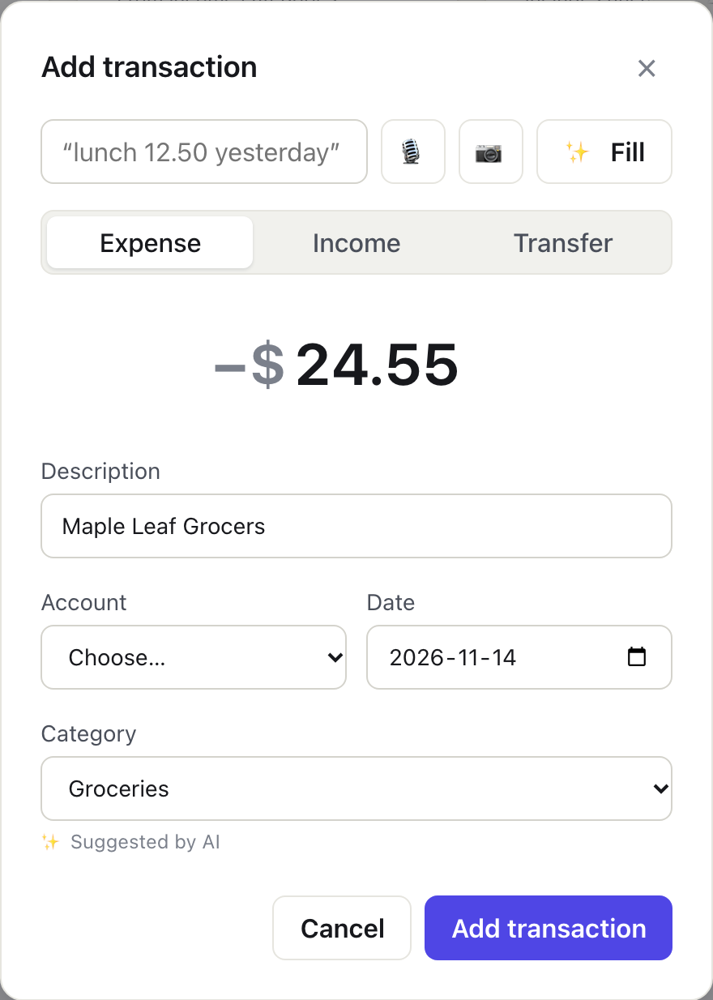
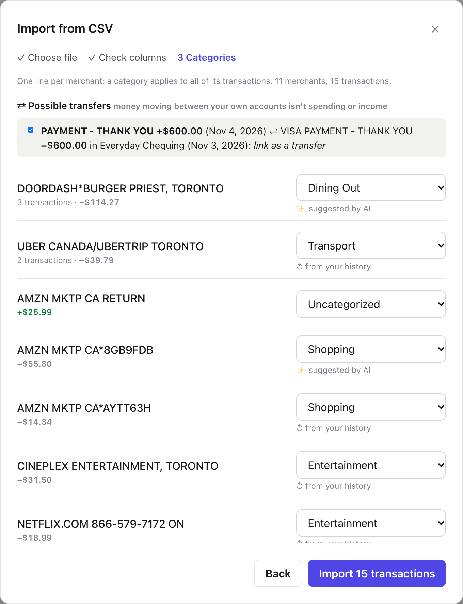
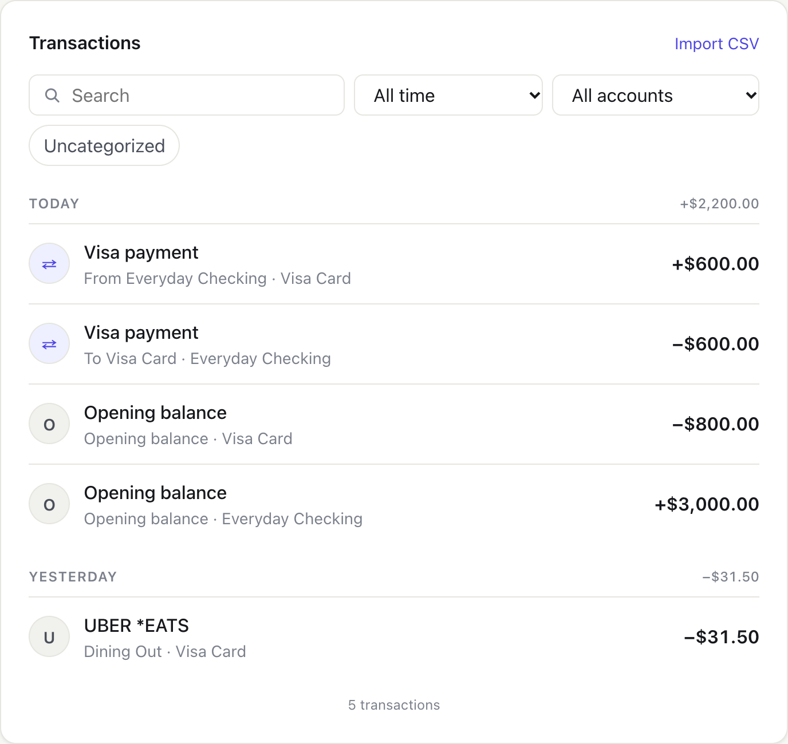
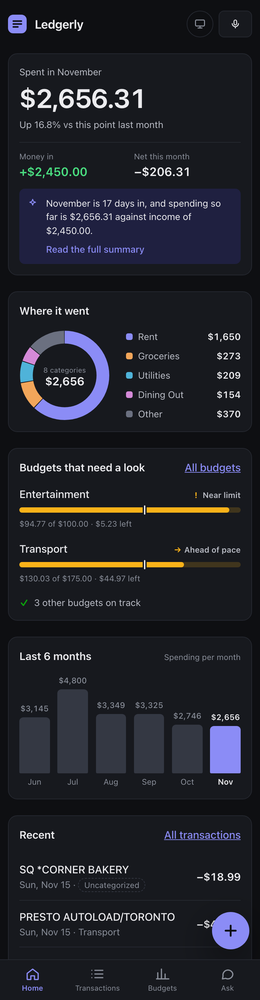

# Ledgerly

**A personal finance ledger you can talk to.** Type, say or photograph a purchase and
it fills itself in; import a bank CSV and it categorizes everything; ask *"Am I over
budget on anything?"* and get an answer from your real data, with every number computed
by code, never invented by the AI.



> **Design principle:** the AI only *proposes*. Code validates every field, computes every
> number, and the user confirms before anything is saved.

---

## Features

**Core ledger**
- Accounts (checking, savings, credit card, cash) with balances **derived** from transactions
- Transactions with search and filters, categories, monthly budgets with pace markers
- **Transfers between accounts** stored as linked pairs, so a credit-card payment isn't
  counted as both spending and income
- **CSV import** from any bank: column auto-detection, date-format detection, sign
  flipping for credit cards, duplicate skipping, and suggested **transfer pairs** across files

**AI features** (DeepSeek `deepseek-flash`)

| Feature | What it does |
|---|---|
| **Auto-categorize** | Suggests a category as you type; reuses your own history first (free, instant) |
| **✨ Fill** (typed or 🎙 spoken) | *"coffee at Tims for 4 and chips at Five Guys for 15 today"* → two draft transactions, filled in one after another |
| **📷 Receipt scanning** | A photo → store, final total, date and category, shrunk in the browser and never stored |
| **Ask your ledger** | Answers questions with an **agent loop** over read-only SQL tools plus a calculator tool |
| **Monthly insights** | A written summary of the month; a guard drops any sentence with a number not in the computed facts |
| **Batch categorization** | A 300-row bank file → a few AI calls (history first, de-duplicated merchants, batches of 50) |

| | | |
|---|---|---|
|  |  |  |
| **✨ Fill** with a queue for the second purchase | **Ask your ledger** shows what each answer is based on | **📷 Receipt** read into the form |
|  |  |  |
| **CSV import** spotting a card payment in two files | **Transfers** shown as ⇄ pairs | Phone width, **dark mode** |

---

## How the AI is designed

These are the parts most worth reading in the code:

1. **One provider module.** [`server/src/ai/client.js`](server/src/ai/client.js) is the only
   file that knows about DeepSeek. Features call `completeJson()` or `runTools()`; tests
   inject a fake, so the test suite is free, fast and offline.
2. **Never trust model output.** Every field the AI returns goes through the same
   validation as user input (real dates, not in the future; amounts parsed by our code
   into integer cents; categories must exist and be the right kind). Invalid → empty, not
   an error.
3. **Tool use with guardrails.** *Ask your ledger* gives the model six read-only tools
   (spending by category, transactions, balances, budgets, monthly totals, calculator).
   The model never touches the database; the loop is capped at 5 rounds; bad tool
   arguments are returned as errors so it can correct itself; AI text only reaches SQL
   through `?` placeholders.
4. **Numbers come from code.** Tools return pre-formatted amounts and percentages; a
   `calculate` tool does exact integer-cent arithmetic; monthly insights are checked
   number by number against the facts.
5. **The cheapest AI call is no AI call.** The user's own history answers first; the
   AI is asked only about unknown merchants, in batches.
6. **Output shape over prompt tweaks.** When "two purchases in one sentence" gave three
   different wrong answers, the fix was a *list* schema, not a cleverer prompt.

The full reasoning (alternatives, results, costs and known limitations for every
feature) is in the **[design doc](docs/design/ai-features.md)**, including a decision log.

---

## Architecture

```
React (Vite) ──/api──► Express ──► SQLite (node:sqlite, raw SQL, migrations)
                          │
                          └──► server/src/ai/client.js ──► DeepSeek API
```

- **Money is integer cents** everywhere; dollars only for display.
- **Balances are derived** (`SUM` of transactions), never stored.
- **Multi-step writes** (imports, transfers) use database transactions: all or nothing.
- **Schema changes** go through numbered migrations (`PRAGMA user_version`), each tested
  against a frozen copy of the previous schema.
- **The API key stays on the server**; the browser never sees it.

| | |
|---|---|
| Backend | Node.js 24, Express 5, `node:sqlite` |
| Frontend | React, Vite, plain CSS with design tokens (light + dark) |
| AI | DeepSeek via the `openai` SDK (OpenAI-compatible API) |
| Parsing | `papaparse` for CSV |
| Tests | Vitest + Supertest: **420 server tests, 215 client tests** |

---

## Running it locally

**Requirements:** Node.js 24+, and a [DeepSeek API key](https://platform.deepseek.com)
for the AI features. The ledger works without one; AI features say they're unavailable.

```bash
git clone https://github.com/Pooja9810/ai-ledger.git && cd ai-ledger
cd server && npm install && cp .env.example .env   # add DEEPSEEK_API_KEY to .env
cd ../client && npm install
```

Two terminals:

```bash
# 1. API with fake demo data (never touches your real ledger.db)
cd server && npm run seed && npm run dev:demo        # http://localhost:3001

# 2. Web app (proxies /api to the server)
cd client && npm run dev                             # http://localhost:5173
```

Use `npm run dev` instead of `dev:demo` for your real ledger (`server/ledger.db`).
To try CSV import, use the fake bank exports in **[`samples/`](samples/)**.

**Tests:** `cd server && npm test` · `cd client && npm test`

---

## Project structure

```
server/src/
  ai/            client.js (provider), categorize*, parse-transaction, scan-receipt,
                 ledger-tools + calculator + ask-ledger (agent), insights
  routes/        accounts, transactions (+ import), transfers, categories, budgets,
                 summary, ai
  db/            schema.sql (latest schema), migrations.js
  import-transactions.js, transfer-matching.js, transfers.js, merchants.js
client/src/
  components/    dashboard cards, Add Transaction dialog, Import dialog
  *.js           pure, tested logic: csv, importer, draft, ask, speech, image, transfer…
docs/design/     ai-features.md, the design doc and decision log
samples/         fake bank CSVs + generator
```

---

## Known limitations & next steps

- Single user, no authentication yet (a requirement before any public deployment with
  real data).
- Merchant matching is text-based: `AMZN MKTP` vs `Amazon` won't match history.
- Transfers link two accounts; split transactions (one receipt, several categories)
  would call for full double-entry, considered and deferred (see the design doc).
- Receipt numbers for exact duplicate detection: designed, deferred until needed.

---

## About this project

Built as a portfolio project by **Pooja** with
[Claude Code](https://claude.com/claude-code) as an AI pair programmer. The design
decisions (provider choice, data model, matching rules, UX trade-offs) were discussed and
made step by step, and are recorded with their reasoning in the
[design doc](docs/design/ai-features.md).
